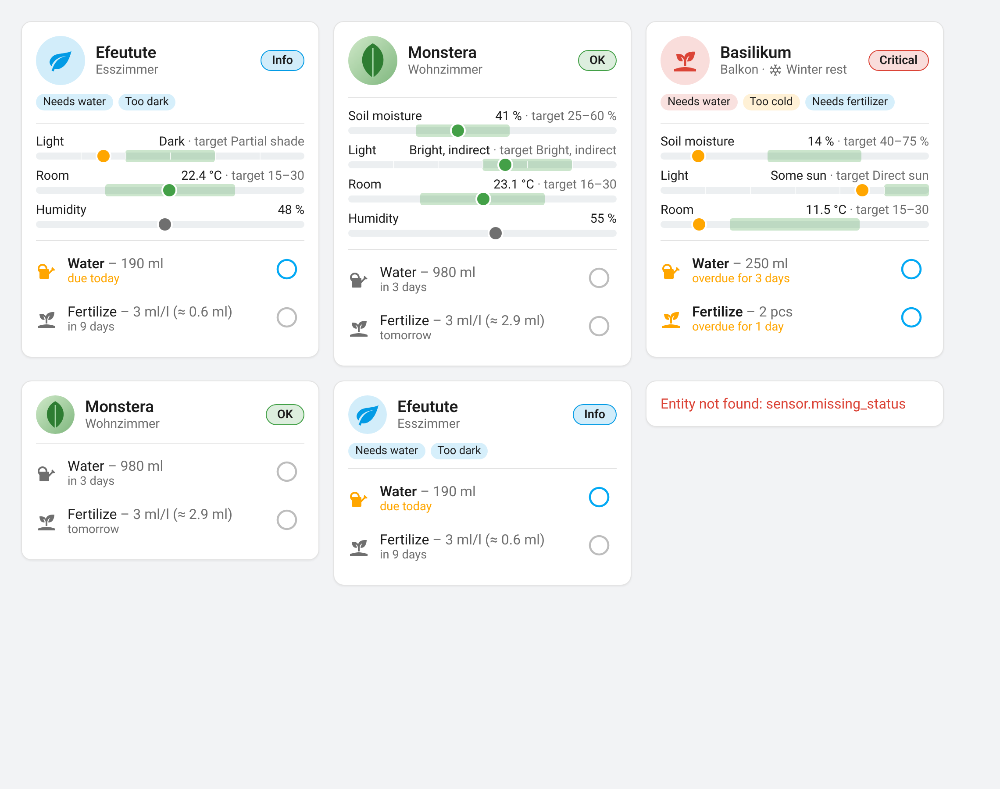
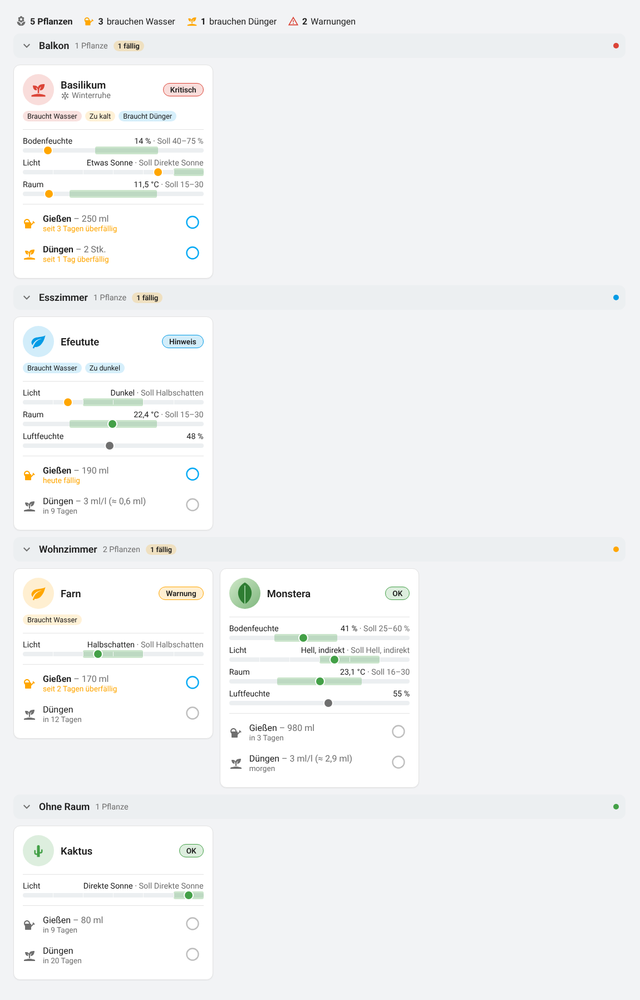

<picture>
  <source media="(prefers-color-scheme: dark)" srcset="docs/wordmark-dark.png">
  
</picture>

# Plant Butler 🌿

*[Deutsche Version](README.de.md)*

A Home Assistant integration for plant care: every plant is a device with target values from a bundled plant database, optional sensors, a care assistant for watering amount and fertilizer dose, watering and fertilizing schedules, warning levels and a checklist that resets itself.

> Status: **0.4** – notification blueprint is next.

## Features

- **"+ Add plant"** right on the integration page (config subentries), with the room taken from your Home Assistant areas.
- **Plant database** with 118 common house, balcony and herb plants. Picking a species prefills all target values; "Custom" for anything else.
- **Care assistant** while adding a plant: from pot size, pot material, substrate and your fertilizer it calculates watering amount, watering interval and fertilizer dose (see below).
- **Optional sensors**: soil moisture, light, room temperature, room humidity. Matching sensors of the chosen room are suggested.
- **Watering**
  - with a soil sensor: "water below" threshold with hysteresis, forecast from the trend, watering is detected automatically from the moisture rise;
  - without a soil sensor: the interval from the assistant, adjusted at runtime by the room climate (vapour pressure deficit from temperature and humidity) and winter rest.
- **Light**: six levels for target and actual (very dark … direct sun). With a light sensor the daily light integral (DLI) is calculated; without one you pick the location's light from a dropdown.
- **Fertilizing** with interval, separate winter interval (0 = pause), amount and fertilizer type.
- **Status** ok / info / warning / critical with a list of causes.
- **Checklist** `todo.plant_butler`: due tasks appear automatically, ticking resets the schedule, done items disappear after 24 h.
- **Event** `plant_butler_notification` for new or escalating problems.
- Entity IDs are always English; the UI is available in English and German.

## Installation (HACS)

1. HACS → ⋮ → *Custom repositories* → `https://github.com/DomJoke/ha-plant-butler`, type *Integration*.
2. Install "Plant Butler" and restart Home Assistant.
3. *Settings → Devices & services → Add integration → Plant Butler*.
4. On the integration page, click **"+ Add plant"**.

## Care assistant

The assistant uses rules of thumb for potted plants. All results are suggestions you can change in the last step or later via the plant's entities.

| Value | How it is calculated |
| --- | --- |
| Pot volume | Cylinder from diameter and height (height defaults to 0.9 × diameter) × 0.8 for the tapered shape |
| Watering amount | Pot volume × plant-available water of the substrate (potting soil 25 %, mineral/cactus soil 15 %) × share used up before watering again (very low 90 %, low 70 %, medium 50 %, high 35 %, very high 25 %), rounded to 10 ml |
| Watering interval | Base interval of the water need level × pot size (2 l = 1.0, larger pots dry slower) × material (terracotta 0.8) × substrate (mineral 0.85) × light at the location (dark 1.25 … direct sun 0.8) × plant size relative to the pot (small 1.2, normal 1.0, large 0.8), limited to 0.6–1.6 |
| Liquid fertilizer | Package dose (ml/l) × nutrient demand (light feeder ½, medium ¾, heavy feeder full); the checklist also shows the total ml for one watering |
| Fertilizer sticks | 1–4 sticks by pot diameter, every 90 days |
| Slow-release granules | 2.5 g per litre of substrate (scaled by nutrient demand), every 180 days |

Example: a pothos in a 14 cm plastic pot in a dark spot → about 1.6 l → **190 ml every 8 days**.

At runtime the room climate (warm, dry air → shorter) and winter rest (× 1.5) adjust the interval further. Changing the water need or light level of a plant re-runs the assistant for the interval.

## Water need levels

| Level | Examples | Water below | Moisture max | Base interval |
| --- | --- | --- | --- | --- |
| Very low | cacti, succulents | 10 % | 35 % | 21 days |
| Low | ZZ plant, snake plant | 15 % | 45 % | 14 days |
| Medium | monstera, ficus, pothos | 25 % | 60 % | 7 days |
| High | ferns, calathea | 40 % | 75 % | 4 days |
| Very high | papyrus, balcony herbs | 55 % | 90 % | 2 days |

These are guide values. Soil sensors read differently depending on the manufacturer – adjust "water below" to your readings.

## Entities per plant (example "Monstera")

| Entity | Meaning |
| --- | --- |
| `sensor.monstera_status` | OK / notice / warning / critical; attribute `summary` explains why (e.g. "Location too dark"); further attributes for cards |
| `sensor.monstera_next_watering` / `sensor.monstera_next_fertilizing` | Due time (timestamp) |
| `sensor.monstera_light_level` / `sensor.monstera_dli` | Actual light level / daily light integral today (light sensor only) |
| `binary_sensor.monstera_needs_water` / `_needs_fertilizer` | Yes / No |
| `sensor.monstera_light_condition` | Suitable / too dark / too bright |
| `sensor.monstera_temperature_condition` | Suitable / too cold / too warm (room temperature sensor only) |
| `button.monstera_mark_watered` / `_mark_fertilized` | Task done |
| `select.monstera_water_need` / `_light_need` / `_location_light` / `_plant_size` | Target levels, light at the location, plant size relative to the pot |
| `number.monstera_moisture_min` / `_moisture_max` / `_temperature_min` / `_temperature_max` / `_watering_interval` / `_watering_amount` / `_fertilizer_interval` / `_fertilizer_winter_interval` / `_fertilizer_amount` | Fine-tuning |
| `switch.monstera_winter_rest` | Winter rest: watering interval × 1.5, fertilizing by winter interval |
| `image.monstera_photo` | Photo (if set) |

Visibility: target values (selects, numbers, winter rest) are *configuration* entities, light level and DLI are *diagnostic* entities – both are kept out of auto-generated dashboards. Temperature min/max, moisture maximum and the winter fertilizing interval are **disabled by default**; enable them on the device page if you want to fine-tune them.

## Plant card

The integration ships a dashboard card and loads it automatically – no resource needs to be added. In the dashboard editor choose **"Plant Butler"** from the card picker, or:

```yaml
type: custom:plant-butler-card
entity: sensor.monstera_status
compact: false      # optional: header and tasks only
show_bars: true     # optional: sensor values against target ranges
show_tasks: true    # optional: watering/fertilizing with tick buttons
```



The card shows the photo (or the species icon), status, problems, soil moisture / light / room temperature / humidity against the plant's targets, and the next care tasks. Tapping the circle next to a task marks it as done (`plant_butler.mark_done`); tapping the header or a value opens the details.

## Plants dashboard

Plant Butler ships a **dashboard strategy**: the dashboard is generated each time it opens, so new plants and rooms appear automatically.

1. *Settings → Dashboards → Add dashboard → New dashboard from scratch*, name it e.g. "Plants".
2. Open it, ⋮ → *Edit dashboard* → ⋮ → *Raw configuration editor*, replace everything with:

```yaml
strategy:
  type: custom:plant-butler
```

It has two views:

- **Overview** – all plants grouped by room. Each room can be collapsed (remembered per browser); the header shows the number of plants, how many are due and the worst status.
- **Due** – only plants with a due task, as compact cards to tick off, plus the `todo.plant_butler` list.



The overview is also available as a card for any dashboard:

```yaml
type: custom:plant-butler-overview-card
filter: all          # or: due
area: wohnzimmer     # optional: only one room
compact: false
collapsible: true
group_by_room: true
show_summary: true
```

## Status levels

| Status | Meaning |
| --- | --- |
| OK | Nothing to do |
| Notice | Something to know or do soon: watering due today, fertilizing due, location a bit dark (no sensor), soil a little wet |
| Warning | Should be handled: watering more than 1 day overdue, temperature outside the range, light too low/high for 3 days |
| Critical | Act now: soil very dry or watering long overdue, temperature far outside the range |

The status sensor's `summary` attribute lists the reasons in plain words.

## Service

```yaml
action: plant_butler.mark_done
data:
  entity_id: sensor.monstera_status   # or device_id
  task: water                          # or fertilize
```

## Notifications (example until the blueprint is available)

```yaml
triggers:
  - trigger: event
    event_type: plant_butler_notification
conditions:
  - condition: template
    value_template: "{{ trigger.event.data.severity in ['warning', 'critical'] }}"
actions:
  - action: notify.mobile_app_my_phone
    data:
      title: "🌿 {{ trigger.event.data.plant }} ({{ trigger.event.data.area }})"
      message: "{{ trigger.event.data.problem }} – {{ trigger.event.data.severity }}"
```

## Development

```bash
pip install -r requirements_test.txt
pytest
```

The integration icon lives in `custom_components/plant_butler/brand/` (shown by Home Assistant 2026.3 and newer); its source is `tools/brand/build.py` (all style options), `tools/brand/export.py` (exports the chosen ring icon; the logo files are copies of the icon) and `tools/brand/export_wordmark.py` (README wordmark).

The plant database is generated from `tools/species.tsv` with `tools/build_db.py`; translations are generated with `tools/build_translations.py`.
